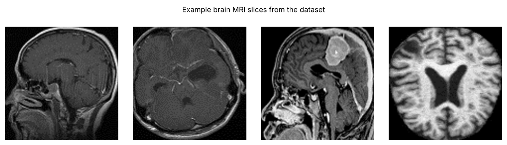
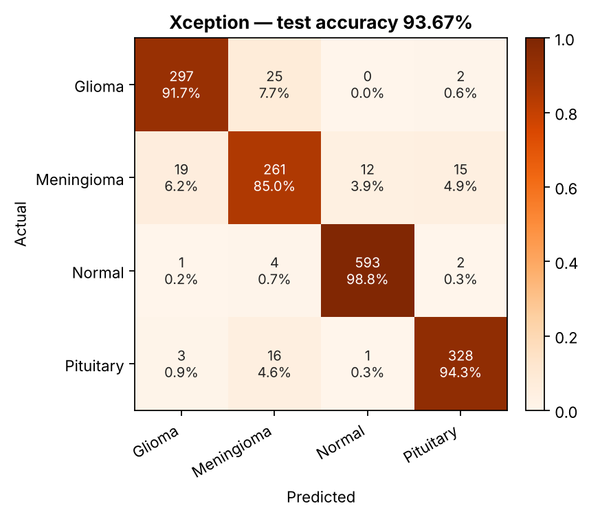
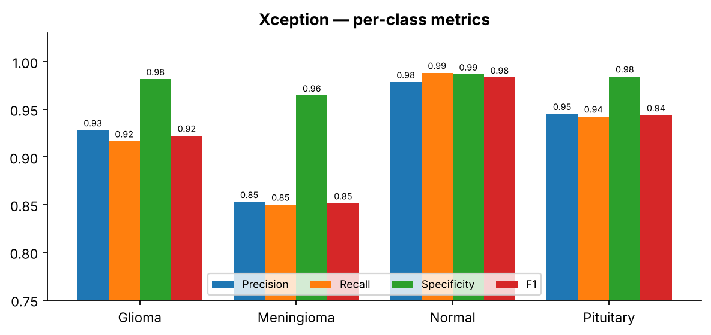
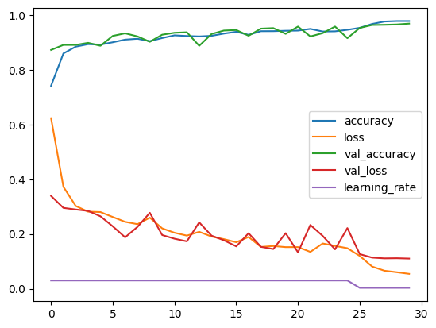
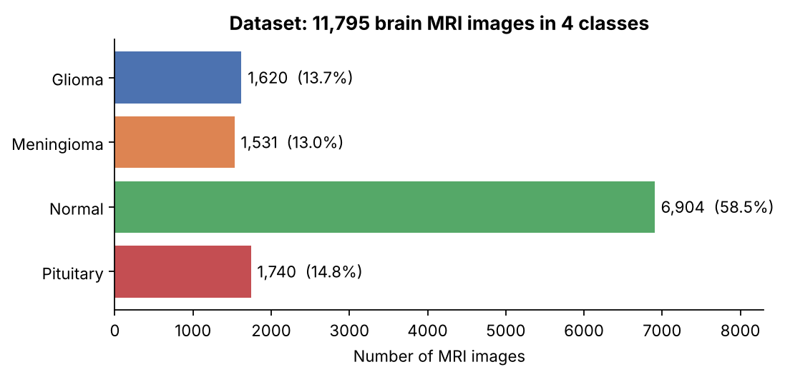
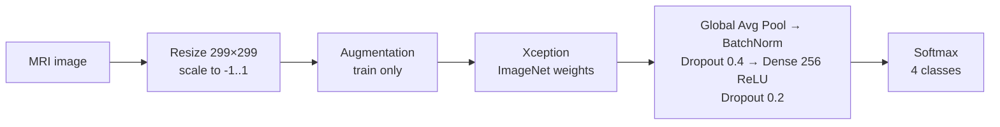

<h1 align="center">🧠 Brain Tumor MRI Classification with Xception</h1>

<p align="center">
  
  
  
  
  
</p>

<p align="center">
  Transfer learning with an ImageNet-pretrained <b>Xception</b> to classify brain MRI images into<br>
  <b>Glioma · Meningioma · Pituitary tumor · Normal</b><br>
  Research project carried out in collaboration with <b>Kerman University of Medical Sciences</b>, Iran.
</p>

<p align="center"></p>

> This model is one member of a three-CNN ensemble. The ensemble (96.26 % accuracy) is in
> **[brain-tumor-mri-ensemble](https://github.com/goharisaleh/brain-tumor-mri-ensemble)**.

## 📊 Results

**Test accuracy: 93.67%** (1479 / 1579 images) · macro F1 0.925 · mean specificity 0.979

<p align="center"></p>

| Class | Precision | Recall (sensitivity) | Specificity | F1-score | Support |
|---|:---:|:---:|:---:|:---:|:---:|
| Glioma | 0.928 | 0.917 | 0.982 | 0.922 | 324 |
| Meningioma | 0.853 | 0.850 | 0.965 | 0.852 | 307 |
| Normal | 0.979 | 0.988 | 0.987 | 0.983 | 600 |
| Pituitary | 0.945 | 0.943 | 0.985 | 0.944 | 348 |
| **Macro average** | **0.926** | **0.924** | **0.979** | **0.925** | **1579** |

Most frequent errors: Glioma → Meningioma (25), Meningioma → Glioma (19), Pituitary → Meningioma (16).

<p align="center"></p>

### Training curves (original experiment)

<p align="center"></p>

## 🗂️ Dataset

[**MRI Scans – Brain Neurological Classes**](https://www.kaggle.com/datasets/omarradi1993/mri-scans-brain-neurological-classes) (Kaggle) — 11,795 T1-weighted contrast-enhanced brain MRI images, 512 × 512 JPG. Split: 70 % train, 10 % validation, 20 % test (stratified).

<p align="center"></p>

## 🏗️ Model and tuning



| Component | Setting |
|---|---|
| Input | 299 × 299 × 3, scaled to [-1, 1] inside the model |
| Augmentation | flip, rotation, translation, zoom, shear, brightness, contrast, Gaussian noise |
| Stage 1 | backbone frozen, new head trained 6 epochs (AdamW, lr 1e-3) |
| Stage 2 | top 50 % of Xception unfrozen (BatchNorm frozen), lr 1.0e-4 |
| Regularisation | label smoothing 0.1, class weights, L2 + weight decay, dropout |
| Schedule | ReduceLROnPlateau, EarlyStopping (restores best weights), best-checkpoint saving |

All settings are in [`configs/default.yaml`](configs/default.yaml).

## 🚀 Quick start

```bash
git clone https://github.com/goharisaleh/brain-tumor-mri-xception.git
cd brain-tumor-mri-xception
pip install -r requirements.txt

bash scripts/download_data.sh                      # needs ~/.kaggle/kaggle.json
python -m src.train --model xception                  # train + evaluate
python -m src.predict --model xception --images my_scan.jpg --gradcam
```

Change any setting from the command line, e.g. `--set train.batch_size=16 train.finetune_epochs=40`.
On Google Colab use [`notebooks/colab_quickstart.ipynb`](notebooks/colab_quickstart.ipynb).

Outputs (in `outputs/xception/`): `best_model.keras`, `metrics.json`, `classification_report.txt`, `confusion_matrix.png`, `roc_curves.png`, `training_curves.png`.

## 🔗 Related repositories

- [**Ensemble of all three models**](https://github.com/goharisaleh/brain-tumor-mri-ensemble) (best result)
- [InceptionResNetV2](https://github.com/goharisaleh/brain-tumor-mri-inceptionresnetv2)
- [InceptionV3](https://github.com/goharisaleh/brain-tumor-mri-inceptionv3)

## 📝 Notes

- The results above come from the original experiment. Re-running the code gives slightly different numbers (random initialisation, GPU, library versions).
- Metrics are computed from `model.predict()` on an ordered, non-augmented test set.

## 👤 Author

**Saleh Goharinezhad** — Computer Vision Engineer · [GitHub](https://github.com/goharisaleh) · [LinkedIn](https://www.linkedin.com/in/saleh-goharinezhad)

## ⚖️ License

[MIT](LICENSE). The dataset belongs to its original authors on Kaggle.

> ⚠️ Research project only — not a medical device and not for clinical diagnosis.
